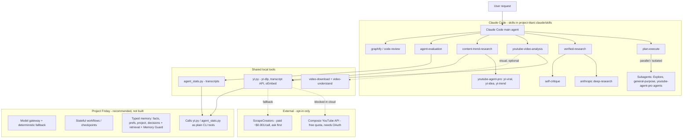

# Agent capability upgrade: research and integration report

Date: 2026-11-21 · Source studied: [ashishpatel26/500-AI-Agents-Projects](https://github.com/ashishpatel26/500-AI-Agents-Projects) (MIT, ★40.1k, last push 2026-11-06)

## TL;DR

- The "500+" repo is a **curated link index** (~110 linked use cases) plus **21 small in-repo demo agents**
  (~100 lines each, 20 of 21 hard-wired to paid OpenAI `gpt-4o`/`gpt-4o-mini`, single-pass, no verification).
  Several links have rotted: the LangGraph tutorials moved to `examples/`, some Agno cookbook files moved, and AutoGen and
  crewAI-examples are **archived**. Its value is as a map to good patterns. The in-repo code itself isn't worth installing.
- Your environment already had most of the heavy capabilities (deep-research, 24 YouTube strategy skills, video
  download/understanding, graphify, code review). The real gaps were **data collection for YouTube** and
  **verification/critique loops**. Those are what I built: 6 small skills and 2 stdlib scripts, no frameworks.
- **Project Friday was not present in this environment.** Only `project-titan` (a README) exists here. Friday-specific
  placement below is a recommendation and should be checked against the real Friday code.

---

## Phase 1: System audit (read-only)

| Area | Found |
|---|---|
| Repo | `project-titan`: "AI Documentary Video Generation Platform". README only, 1 commit |
| Runtime | Python 3.13, Node 22, uv, ffmpeg 6.1, git, gh, jq, rg. **Missing:** yt-dlp, whisper, youtube-transcript-api |
| Plugins | ponytail, youtube-agent-pro (24 skills + 5 agents), lemo-opuscar, trader-skill |
| Skills (user) | ~55: OpenMontage pack (video gen, TTS/STT, remotion, manim, ffmpeg, `video-download`, `video-understand`, …), earshot, openfilm, graphify |
| Skills (built-in) | `anthropic-skills:deep-research`, code-review, security-review, simplify, pdf/docx/xlsx/pptx |
| MCP | earshot (local), Composio (YouTube API needs OAuth; ScrapeCreators connected, **paid per call**), GitHub |
| Memory | Claude Code CLAUDE.md + per-project transcripts. No vector/semantic memory |
| Agents/orchestration | Native Claude Code Agent tool + TaskCreate. youtube-agent-pro agents (strategist, producer, packager, editor, analyst) |
| Network | Limited allowlist. `www.youtube.com` allowed, but YouTube **bot-walls this datacenter IP** (redirect to `google.com/sorry`), so yt-dlp and transcript fetching fail from the cloud. oEmbed works |
| Persistence | `~/.claude` is rebuilt by the environment setup script each session. **Anything not in a repo is lost**, so the new skills live in this repo |

**Duplicates to avoid:** research (deep-research exists), trend/idea/retention analysis (youtube-agent-pro), codebase maps
(graphify), code review (3 skills), video frames/transcription (video-understand).

**Missing before this work:** fetching YouTube metadata, transcripts and channel listings; claim verification with independence
checks; a bounded self-critique loop; explicit plan/retry/replan rules; any agent metrics.

---

## Phase 2: Candidate list (scored 1-10 for *your* environment, not in general)

Stars and licences verified via GitHub search on 2026-11-21. "Repo-level" stars apply to the whole framework repo.

| # | Candidate | Source | Purpose / architecture | Stack · licence · ★ · status | Cost/local | Integration | Score |
|---|---|---|---|---|---|---|---|
| 1 | Agno YouTube toolkit | [agno/tools/youtube.py](https://github.com/agno-agi/agno/blob/main/libs/agno/agno/tools/youtube.py) (README link `youtube_agent.py` is dead) | Single agent + tools: oEmbed metadata, captions, caption timestamps | Python · Apache-2.0 · ★43k · active | free, local | **Extract**: core logic is ~100 lines | 8 |
| 2 | LangGraph Plan-and-Execute | [examples/plan-and-execute](https://github.com/langchain-ai/langgraph/tree/main/examples/plan-and-execute) | Planner → executor → replanner | Python · MIT · ★45k · active | needs LLM API | Extract concept → Claude Code tasks | 8 |
| 3 | LangGraph Reflection | [examples/reflection](https://github.com/langchain-ai/langgraph/tree/main/examples/reflection) | Generate ↔ critique loop | same | API | Extract concept | 7 |
| 4 | LangGraph Reflexion | [examples/reflexion](https://github.com/langchain-ai/langgraph/tree/main/examples/reflexion) | Critique grounded in external evidence (search), bounded iterations | same | API | Extract concept | 8 |
| 5 | LangGraph Corrective RAG | [examples/rag/langgraph_crag.ipynb](https://github.com/langchain-ai/langgraph/tree/main/examples/rag) | Grade retrieved docs → re-search on low relevance | same | API (+local variant) | Extract concept (research gap loop) | 7 |
| 6 | LangGraph Self-RAG / Adaptive RAG (+local) | examples/rag | Self-grading retrieval. Local Ollama variants | same | local possible | Reference for Friday RAG | 6 |
| 7 | LangGraph Supervisor | [examples/multi_agent](https://github.com/langchain-ai/langgraph/tree/main/examples/multi_agent) | Supervisor routes to workers | same | API | Concept → delegation rules | 6 |
| 8 | LangGraph Hierarchical teams | examples/multi_agent | Supervisors of supervisors | same | API | Reference only (overkill) | 4 |
| 9 | LangGraph Code Assistant | examples/code_assistant | Generate → test → reflect → retry | same | API | Already native to Claude Code | 4 |
| 10 | LangGraph Chatbot simulation eval | examples/chatbot-simulation-evaluation | Simulated-user evaluation | same | API | Reference for Friday evals | 5 |
| 11 | In-repo `01-web-research-agent` | agents/01 | Tavily search → one-shot summary | LangGraph · MIT | **Tavily + OpenAI paid** | Reject: single pass, no verification, deep-research is better | 2 |
| 12 | In-repo `20-multi-agent-debate` | agents/20 | Pro/con agents + judge | LangChain · MIT | OpenAI paid | Extract concept: optional critic | 3 |
| 13 | In-repo `02-code-review`, `15-unit-test-generator`, `16-documentation-writer` | agents/02,15,16 | One-prompt wrappers | LangChain · MIT | OpenAI paid | Reject: Claude Code already does this better | 2 |
| 14 | In-repo `06-news-summarizer`, `19-competitive-analysis` | agents/06,19 | Search + summarize | LangChain · MIT | paid APIs | Reject: superseded | 2 |
| 15 | In-repo `21-pii-sanitization-agent` | agents/21 | Regex PII redaction | Python · MIT | free | Reference for Friday logging | 4 |
| 16 | Agno Media Trend Analysis agent | agno cookbook (README link dead, file moved/removed) | Search + scrape trend report | Apache-2.0 | Exa/Firecrawl paid | Reject: link dead, paid tools, youtube-agent-pro covers it | 3 |
| 17 | Agno Research / DeepKnowledge agents | now `cookbook/90_models/groq/deep_knowledge.py`, `research_agent_exa.py` | Iterative KB search | Apache-2.0 | Groq/Exa API | Reference only | 4 |
| 18 | Agno teams "broadcast research sweep" | `cookbook/03_teams/02_modes/broadcast/03_research_sweep.py` | Parallel agents on one query | Apache-2.0 | API | Concept (= parallel subagents) | 5 |
| 19 | AutoGen group chat / nested chat / FSM | microsoft/autogen 0.2 notebooks | Multi-agent conversation patterns | CC-BY-4.0 docs · ★62k · **archived** | API | Reference only (archived) | 3 |
| 20 | AutoGen AgentEval | autogen notebook | LLM-judged task utility criteria | archived | API | Extract concept: task-level eval record | 4 |
| 21 | AgentOps | [AgentOps-AI/agentops](https://github.com/AgentOps-AI/agentops) | Hosted tracing/cost | MIT · ★6k · last push 2026-06 | SaaS (free tier), sends data out | Reject for now: transcripts already have the data | 3 |
| 22 | Citadel | [SethGammon/Citadel](https://github.com/SethGammon/Citadel) | Operating layer for Claude Code: routing, hooks, 131 skills, dashboard | Node 22 · MIT · ★936 · active | free, local | Reference only: large, global hooks, overlaps ponytail and the new skills | 5 |
| 23 | OWASP Agent Memory Guard | [OWASP/www-project-agent-memory-guard](https://github.com/OWASP/www-project-agent-memory-guard) | Detects memory-poisoning (ASI06) | Python · Apache-2.0 · ★208 · active | free, local | Adopt in **Friday** once it has persistent memory | 6 |
| 24 | CrewAI flows (self-evaluation loop, screenplay writer) | crewAI-examples (**archived**) | Role crews | Python · no licence file · archived | API | Reject: archived, no licence | 2 |
| 25 | NirDiamant/GenAI_Agents | [repo](https://github.com/NirDiamant/GenAI_Agents) | 40+ tutorial notebooks | ★25k · licence NOASSERTION (custom, non-commercial clauses) | API | Reference only: licence not permissive | 4 |

Not candidates (domain-specific, irrelevant to the goals): healthcare, trading, farming, real-estate, logistics, gaming agents.

---

## Phase 3: Top 10 deep investigation

| Candidate | Verified in code | Deps / APIs | Security | Verdict |
|---|---|---|---|---|
| Agno YouTube tool | Yes: `urlopen` to oEmbed, `YouTubeTranscriptApi().fetch`, timestamps from caption starts. No keys | youtube-transcript-api | Only calls youtube.com. No creds | **EXTRACT**: reimplemented in `yt.py` with yt-dlp metadata, chapters, VTT fallback and evidence labels. No Agno dependency |
| Plan-and-Execute | Planner/executor/replanner nodes over LangChain | LangGraph + LLM API | n/a | **EXTRACT CONCEPT** → `plan-execute` skill on native tasks/subagents |
| Reflexion | Critique cites search results, revision loop with max iterations | LangGraph, Tavily | n/a | **EXTRACT CONCEPT** → evidence-grounded critique, hard 2-round cap (`self-critique`) |
| Reflection | Simple generate↔critique | LangGraph | n/a | **EXTRACT CONCEPT** (merged into `self-critique`) |
| CRAG | Grade docs → web search fallback | LangGraph, Tavily | n/a | **EXTRACT CONCEPT** → "one targeted re-search for weak load-bearing claims" |
| Supervisor | Router LLM picks the next worker | LangGraph | n/a | **EXTRACT CONCEPT** → "delegate only when parallel / isolating / reviewing" table |
| Multi-agent debate (in-repo) | 2 debaters + judge, fixed rounds, gpt-4o | OpenAI paid | Keys via .env, fine | **EXTRACT CONCEPT** → optional fresh-context critic |
| AgentEval | LLM-proposed criteria + quantifier | AutoGen (archived) | n/a | **EXTRACT CONCEPT** → task-level eval record in `agent-evaluation` |
| OWASP Memory Guard | Scanner + semgrep rules + MCP server | Python | Apache-2.0, OWASP-maintained | **REFERENCE** now. **INSTALL in Friday** when it gains writable memory |
| Citadel | Plugin + hooks + skills. Pinned releases, threat model doc | Node 22 | Installs hooks that run on every tool call | **REFERENCE ONLY**: re-evaluate if you want fleet orchestration |

Rejected outright: all paid-OpenAI in-repo demos (Claude Code supersedes them), archived CrewAI examples (no licence),
AgentOps (sends traces to a SaaS. Local transcripts suffice).

---

## Architecture comparison

| # | Architecture | Best implementation found | Pros | Cons | Use it? |
|---|---|---|---|---|---|
| 1 | Single agent + tools | Claude Code itself; Agno tools | Simplest, most reliable | Context fills on huge tasks | **Default** |
| 2 | Plan and execute | LangGraph plan-and-execute | Visible plan, replanning | Overhead on small tasks | Yes, for 5+ step tasks (`plan-execute`) |
| 3 | Supervisor + specialists | LangGraph supervisor | Clear roles | Handoff loss, cost | Only via existing agents/skills |
| 4 | Hierarchical | LangGraph hierarchical teams | Scales to huge tasks | Heavy, hard to debug | No |
| 5 | Parallel agents | deep-research; Agno broadcast | Wall-clock speed, context isolation | Cost multiplies | Yes, for independent subtopics |
| 6 | Research + verification loop | Reflexion + CRAG | Catches unsupported claims | More searches | **Yes** (`verified-research`) |
| 7 | Reflection loop | LangGraph reflection | Cheap quality boost | Self-agreement bias | Yes, capped at 2 rounds and evidence-grounded |
| 8 | Stateful workflow | LangGraph checkpointers | Resume after interruption | Needs a runtime | **Friday**, not Claude Code (Claude Code has tasks + git) |

---

## Phase 4: Capability architecture



Placement:
- **Claude Code:** skills (instructions) that orchestrate existing tools.
- **Shared tools:** `yt.py`, `agent_stats.py`. These are plain CLIs with JSON output, so Friday can call them unchanged.
- **Friday:** stateful workflows, a model gateway, and typed memory with retrieval. None of these belong in Claude Code skills.
- **External:** only opt-in, with cost stated up front.

Memory (H): no change in Claude Code. Its CLAUDE.md files and on-demand skill loading already retrieve context selectively.
For Friday, store memory as typed records (`fact | preference | project | decision | task-temp | learned`), give each
an expiry or review date for `task-temp`, retrieve top-k by type plus semantic match, and run writes through Memory Guard.

---

## Phase 5: What was implemented

All files are in `project-titan/.claude/skills/` (project-scoped, versioned, and they survive container resets):

| Skill | What it adds | Builds on (no duplication) | Tested |
|---|---|---|---|
| `youtube-video-analysis` | `scripts/yt.py`: metadata (yt-dlp → oEmbed fallback), transcript (file → transcript API → yt-dlp subs), real chapters or fixed windows, hook windows, evidence block. Report template per your spec with `[M][T][V][A][I]` tags | video-download, video-understand, youtube-agent-pro | `--self-check` passes. End-to-end with oEmbed + file transcript passes. **Live yt-dlp/transcript path not verified** (cloud IP bot-walled) |
| `content-trend-research` | Real listings via `yt.py listing` in `swipe.py` format. Pattern = 3+ independent channels. Originality rule | yt-viral, yt-idea, yt-trend | Listing path not live-tested (same block) |
| `verified-research` | Gather → verify → re-search once → verification table | anthropic deep-research, self-critique | Instructions only |
| `self-critique` | Bounded (≤2 rounds) evidence-grounded critique. Profiles: code, research, content, plan | n/a | Instructions only |
| `plan-execute` | Plan with done-checks, retry/replan table, "delegate only when it pays" rules, role → existing skill map | native tasks/Agent tool | Instructions only |
| `agent-evaluation` | `scripts/agent_stats.py`: tool success rate, errors per tool, identical retries, tokens, wall time, subagent share | Claude Code transcripts | `--self-check` passes. Run on this session: 44 tools, 95.5% ok |

Not built, on purpose: a codebase-analysis skill (graphify + code-review cover it), a memory system (belongs in Friday),
an AgentOps/Langfuse stack, and any framework install.

## To use on your own machine

```bash
cd project-titan
uv venv .venv && uv pip install --python .venv/bin/python yt-dlp youtube-transcript-api
.venv/bin/python .claude/skills/youtube-video-analysis/scripts/yt.py video "https://youtu.be/<id>"
```
Skills load automatically when Claude Code runs inside `project-titan`. To use them everywhere, symlink each one into
`~/.claude/skills/`, or add the symlinks to your environment setup script.

## Open items / needs your decision

1. **YouTube from the cloud:** connect YouTube in Composio (free API quota) for metadata and listings, *or* approve
   the paid ScrapeCreators tools for transcripts (~$0.001 per call), *or* run the YouTube skills locally.
2. **Project Friday:** attach its repo to a session so the placement above can be checked against real code.
3. Your message was cut off at "12. REFLECTION AGENT — QUALITY REQUIR…". Send the rest if it has requirements beyond
   what `self-critique` covers.
